  

&nbsp;&nbsp;&nbsp;

Lucknow, India &nbsp;·&nbsp; B.Tech CSE (AI & ML), VIT-AP '27 &nbsp;·&nbsp; CGPA 8.7 / 10

 

I build **computer-vision systems for medical diagnostics**. Right now I'm working on AI-assisted cervical cytology screening that runs on the edge (NVIDIA Jetson AGX Orin).

On the research side, I work on **belief-state learning in POMDPs** with deep recurrent RL. That work received an **IEEE Best Paper Award**.

  

**AI/ML Intern** &nbsp;·&nbsp; Ayukriyam Innovations × MiMD Lab, IIT Delhi  
Cervical cytology classification · detection · dataset engineering

**Focus** &nbsp;→&nbsp; `Computer Vision` &nbsp;`Deep RL` &nbsp;`Computational Pathology` &nbsp;`Edge AI`

  

  

**Cervical-cell Cytology Screening Pipeline**  
Ayukriyam × MiMD Lab, IIT Delhi &nbsp;·&nbsp; Jul 2026 – Present

- **Classification** — 4-class pipeline (NILM · LSIL · HSIL · SCC). Best result: `EfficientNet-B0 V2` → **91.94% test macro-F1**
- **Detection** — benchmarking RF-DETR, DETR and DINO
- **Research** — 54-page literature review across 20+ papers

**[Annotation ExE](https://annotation-exe.onrender.com)** &nbsp;·&nbsp; [Live Demo →](https://annotation-exe.onrender.com/demo/)  
A full-stack image annotation platform for whole-slide images and general computer vision. It streams gigapixel slides as on-demand tiles and supports YOLO / COCO / CVAT.  
`React` `TypeScript` `FastAPI` `PostgreSQL + PostGIS` `Docker`

  

**Belief-State Learning in Partially Observable Environments using DRQN**  
IEEE ICICGR 2026 &nbsp;·&nbsp; Best Paper Award

A Deep Recurrent Q-Network for belief-state estimation in POMDPs, with **~23% higher cumulative reward** than DQN across 16 independent seeds.  
→ [View Code](https://github.com/AnupamMI/DRQN_POMDP_Project)

  

<table>
  <tr>
    <td width="50%" valign="top">
      <h4><a href="https://github.com/AnupamMI/CareLink">CareLink</a></h4>
      AI health app for medication tracking, fitness monitoring and CareScore.  
      <code>React Native</code> <code>Expo</code> <code>TypeScript</code>
    </td>
    <td width="50%" valign="top">
      <h4><a href="https://github.com/AnupamMI/Smart-Glove-Safety-Device">Sign Talk</a></h4>
      Wearable multi-sensor system converting ASL gestures into real-time text.  
      <code>C++</code> <code>Arduino</code> <code>IoT</code>
    </td>
  </tr>
  <tr>
    <td width="50%" valign="top">
      <h4><a href="https://github.com/AnupamMI/Jarvis">J.A.R.V.I.S.</a></h4>
      Browser voice assistant with a reactive Three.js orb and Groq-powered commands.  
      <code>React</code> <code>Three.js</code> <code>Groq</code>
    </td>
    <td width="50%" valign="top">
      <h4><a href="https://github.com/AnupamMI/DRQN_POMDP_Project">DRQN Research Platform</a></h4>
      Configurable POMDP gridworld comparing DQN vs DRQN across 16 seeds.  
      <code>Python</code> <code>PyTorch</code> <code>LSTM</code>
    </td>
  </tr>
</table>

  

| Period | Role |
|:--|:--|
| **Jul 2026 – Present** | AI/ML Intern · Ayukriyam × MiMD Lab, IIT Delhi |
| **Jun – Jul 2026** | Digital Outreach Intern · Australasian Centre for Human Rights and Health |
| **Oct 2024 – Apr 2026** | Technical Team Lead · Microsoft Student Chapter, VIT-AP |
| **2023 – 2024** | Core Member · Machine Learning Club, VIT-AP |

  

| Domain | Tools |
|:--|:--|
| **AI / ML / CV** | Python · PyTorch · TensorFlow · OpenCV · Scikit-learn · NVIDIA Jetson |
| **Web & Mobile** | React · Next.js · TypeScript · Tailwind |
| **Backend & Tools** | FastAPI · PostgreSQL · Docker · AWS · Git |

 

Open to research collaborations, applied ML / CV roles, and interesting builds.

  

&nbsp;&nbsp;

