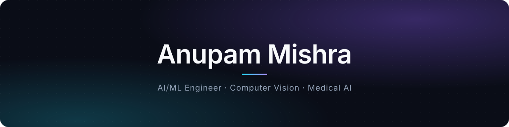

<!-- ═══════════════════════════ BANNER ═══════════════════════════ -->
<p align="center">
</p>

<p align="center">
  <a href="https://www.linkedin.com/in/anupam-mishra-662b8721a/"></a>
  <a href="mailto:anupsm.mishra123@gmail.com"></a>
  
  
</p>

<br/>

<!-- ═══════════════════════════ INTRO ═══════════════════════════ -->
<table>
<tr>
<td width="58%" valign="top">

### Hi, I'm Anupam 👋

I build **computer-vision systems for medical diagnostics**. Right now that's AI-assisted **cervical cytology screening** running on the edge (NVIDIA Jetson AGX Orin), with **IEC 62304-aligned** documentation behind it.

On the research side I work on **belief-state learning in POMDPs** with deep recurrent RL, which earned an **IEEE Best Paper Award**.

📍 Lucknow, India &nbsp;·&nbsp; 🎓 B.Tech CSE (AI & ML), VIT-AP '27

</td>
<td width="42%" valign="top">

```yaml
now:
  role : AI/ML Intern
  at   : Ayukriyam × MiMD Lab, IIT Delhi
  on   : cytology classification,
         detection, regulatory docs
focus:
  - Computer Vision
  - Deep RL
  - Computational Pathology
  - Edge AI
cgpa : 8.7 / 10
```

</td>
</tr>
</table>

<!-- ═══════════════════════════ HIGHLIGHTS ═══════════════════════════ -->
## ⚡ Highlights

<table>
<tr>
<td align="center" width="25%">
<h3>🏆</h3>
<b>IEEE Best Paper</b><br/>
<sub>ICICGR 2026 · Apr 2026</sub>
</td>
<td align="center" width="25%">
<h3>91.94%</h3>
<b>Macro-F1</b><br/>
<sub>4-class cervical cytology<br/>on Jetson AGX Orin</sub>
</td>
<td align="center" width="25%">
<h3>🥇</h3>
<b>1st Place</b><br/>
<sub>APPTHETICS 3.0 · CareLink</sub>
</td>
<td align="center" width="25%">
<h3>🎖️</h3>
<b>Best Socially Relevant Project</b><br/>
<sub>Engineering Clinics Expo · Sign Talk</sub>
</td>
</tr>
</table>

<!-- ═══════════════════════════ CURRENT WORK ═══════════════════════════ -->
## 🩺 Currently Building

**AI pipeline for cervical-cell cytology screening** &nbsp;·&nbsp; *Ayukriyam Innovations × MiMD Lab, IIT Delhi* &nbsp;·&nbsp; Jul 2026 – Present

| | Workstream | What I've done |
|:-:|:--|:--|
| 🔬 | **Classification** | 4-class (NILM · LSIL · HSIL · SCC) pipeline benchmarked on Jetson AGX Orin. Best: **EfficientNet-B0 V2, 91.94% test macro-F1 with TTA** |
| 🎯 | **Detection** | Benchmarking **RF-DETR, DETR and DINO** transformer detectors, with CVAT-based annotation and QC |
| 📚 | **Research** | 54-page literature review across 20+ papers on AI in cervical cytology and computational pathology |
| 📋 | **Regulatory** | IEC 62304-aligned SRTD / SVVP for the **ScopeX** system: 67 requirements with full traceability |

<br/>

**🖍️ Annotation Platform** &nbsp;·&nbsp; *Personal project* &nbsp;·&nbsp; 

An AI-native computer-vision annotation platform built to be a better alternative to CVAT, starting with cytology and whole-slide images and designed to work for any dataset.

- ✏️ **Annotator-first labeling:** freehand add/remove region mask editing, with labeling decisions kept with the human annotator
- 🔬 **Whole-slide image support:** tiled pyramids, resumable uploads, and slide/patient-level dataset splits
- 🤖 **Agentic data management:** AI agents track slides, tiles and progress, import annotated data, and surface analytics like time per image
- 📦 **Dataset engineering:** versioning, review workflow, and YOLO / COCO export

<sub>`React` `TypeScript` `FastAPI` `PostgreSQL` `Redis` `MinIO` `Docker`</sub>

<!-- ═══════════════════════════ PUBLICATION ═══════════════════════════ -->
## 📄 Publication

> **Belief-State Learning in Partially Observable Environments using DRQN**
> IEEE ICICGR 2026 · IEEE Maharashtra Section, SSGMCE Shegaon · Supervised by Dr. Lakhan Dev Sharma, VIT-AP
>
> A Deep Recurrent Q-Network for belief-state estimation in POMDPs: **~23% higher cumulative reward than DQN** across 16 independent seeds. 🏆 *Best Paper Award* &nbsp;·&nbsp; [**Code →**](https://github.com/AnupamMI/DRQN_POMDP_Project)

<!-- ═══════════════════════════ PROJECTS ═══════════════════════════ -->
## 🚀 Featured Projects

<table>
<tr>
<td width="50%" valign="top">

#### 🧠 [Deep RL Research Platform](https://github.com/AnupamMI/DRQN_POMDP_Project)
Configurable POMDP gridworld comparing DQN vs DRQN across 16 seeds. Basis of the Best Paper.<br/>
<sub>`Python` `PyTorch` `LSTM`</sub>

</td>
<td width="50%" valign="top">

#### 🩺 [CareLink — AI Health App](https://github.com/AnupamMI/CareLink)
Medication tracking, fitness monitoring, an AI health assistant and the **CareScore** metric. 🥇 1st Place, APPTHETICS 3.0.<br/>
<sub>`React Native` `Expo` `TypeScript`</sub>

</td>
</tr>
<tr>
<td width="50%" valign="top">

#### 🔊 [J.A.R.V.I.S. Voice Dashboard](https://github.com/AnupamMI/REPLACE-WITH-REPO-NAME)
Browser voice assistant with a voice-reactive Three.js orb, speech in/out and Groq-powered LLM commands.<br/>
<sub>`React` `Three.js` `Web Speech API` `Groq`</sub>

</td>
<td width="50%" valign="top">

#### 🧤 [Sign Talk — Sign Language Glove](https://github.com/AnupamMI/Smart-Glove-Safety-Device)
Wearable multi-sensor fusion that turns ASL gestures into real-time text. 🎖️ Best Socially Relevant Project.<br/>
<sub>`C++` `Arduino` `IoT`</sub>

</td>
</tr>
</table>

<details>
<summary><b>More projects</b></summary>
<br/>

| Project | What it does | Stack |
|:--|:--|:--|
| [AI Skill Gap Radar](https://github.com/AnupamMI/skill-gap-radar) | NLP resume parsing + cosine similarity to map skills to roles and rank learning paths | `Python` `NLP` |
| [AI Contract Analyzer](https://github.com/AnupamMI/ai-contract-analyzer) | Flags key clauses and legal risks in contracts | `Python` `NLP` |
| [NLP Chatbot](https://github.com/AnupamMI/ChatBot) | Intent-recognition chatbot, ~80% accuracy | `Python` `NLP` |

</details>

<!-- ═══════════════════════════ EXPERIENCE ═══════════════════════════ -->
## 💼 Experience

| When | Role | Highlights |
|:--|:--|:--|
| **Jul 2026 – now** | **AI/ML Intern** · Ayukriyam Innovations — MiMD Lab, IIT Delhi | Cervical-cell CV pipeline: detection, classification, dataset prep, evaluation, regulatory docs |
| Jun – Jul 2026 | Digital Outreach Intern · Australasian Centre for Human Rights and Health | Site audit (structure, SEO, engagement); growth framework for the Third National Dowry Abuse Summit 2026 |
| Oct 2024 – Apr 2026 | Technical Team Lead · Microsoft Student Chapter, VIT-AP | Led a 30-member chapter; 5+ workshops on Git, software engineering and Microsoft tech |
| 2023 – 2024 | Core Member · Machine Learning Club, VIT-AP | 3+ ML models across 10+ sessions |
| 2024 | Web Developer · Entrepreneurship Club, VIT-AP | Club site for 100+ users, ~28% faster page loads |

<!-- ═══════════════════════════ TECH STACK ═══════════════════════════ -->
## 🛠️ Tech Stack

<table>
<tr><td><b>AI · ML · CV</b></td><td> &nbsp;    </td></tr>
<tr><td><b>Web & Mobile</b></td><td></td></tr>
<tr><td><b>Backend & Data</b></td><td></td></tr>
<tr><td><b>Hardware · Cloud · Tools</b></td><td></td></tr>
</table>

<!-- ═══════════════════════════ STATS ═══════════════════════════ -->
## 📊 GitHub Activity

<p align="center">
  
  
</p>

<!-- ═══════════════════════════ FOOTER ═══════════════════════════ -->
<p align="center">
  <i>Open to research collaborations, applied ML / CV roles and interesting builds.</i><br/><br/>
  <a href="https://www.linkedin.com/in/anupam-mishra-662b8721a/"></a>
  <a href="mailto:anupsm.mishra123@gmail.com"></a>
</p>
